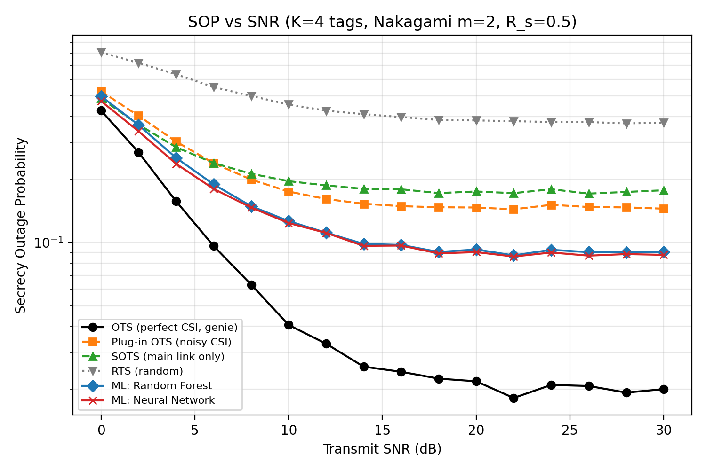

# ML-Based Secure Tag Selection for Ambient Backscatter Communication

[](https://colab.research.google.com/github/<your-username>/ml-tag-selection-backscatter/blob/main/tag_selection_ml.ipynb)

Machine-learning tag selection that keeps a backscatter IoT link secure when the
eavesdropper's channel is only known through **noisy estimates**.

**Author:** Mohammad Nafees, Ph.D. Scholar (ECE), MNNIT Allahabad
**Related work:** [arXiv:2503.12400](https://arxiv.org/abs/2503.12400) — Secrecy analysis of energy-harvesting backscatter communications with tag selection in Nakagami-*m* fading

---

## 1. Problem

An RF source **S** illuminates **K** backscatter tags. The selected tag reflects the
signal to a legitimate reader **D**, while a passive eavesdropper **E** listens.

For tag *k* (dyadic backscatter channel):

- SNR at reader: `SNR_D,k = SNR · β · |h_k|² · |g_k|²`
- SNR at eavesdropper: `SNR_E,k = SNR · β · |h_k|² · |f_k|²`
- Secrecy capacity: `C_s,k = [log2(1+SNR_D,k) − log2(1+SNR_E,k)]⁺`
- Secrecy outage: `SOP = P(C_s < R_s)`

The **optimal tag selection (OTS)** picks the tag with the largest `C_s,k`, but that needs
perfect knowledge of the eavesdropper links `f_k`. A passive eavesdropper never sends
pilots, so in practice `f_k` is known only through a **very noisy estimate**.

## 2. Idea

Train classifiers that map **noisy channel estimates → the truly best tag**:

| Input features (13) | Label |
|---|---|
| Estimated gains of `h_1..h_K`, `g_1..g_K`, `f_1..f_K` (dB) + SNR (dB) | Index of the tag that is best under the *true* channels |

Two models are trained with scikit-learn: **Random Forest** and a **Neural Network (MLP, 64-64)**.

## 3. Schemes compared

| Scheme | What it uses |
|---|---|
| OTS (perfect CSI, genie) | True channels — performance upper bound |
| Plug-in OTS (noisy CSI) | Optimal rule applied directly to noisy estimates |
| SOTS | Only the legitimate link (ignores the eavesdropper) |
| RTS | Random tag |
| ML: Random Forest / Neural Network | Learned from noisy estimates |

## 4. Simulation setup

K = 4 tags · Nakagami *m* = 2 · Ω(main) = 1, Ω(eve) = 0.5 · β = 0.5 · R_s = 0.5 bit/s/Hz ·
estimation-error std 0.1 (legitimate) and 0.6 (eavesdropper) · SNR 0–30 dB ·
64,000 training samples · 20,000 Monte Carlo test samples per SNR point · seed = 42.

## 5. Results



| SNR (dB) | OTS genie | Plug-in OTS | SOTS | RTS | Random Forest | Neural Network |
|---:|---:|---:|---:|---:|---:|---:|
| 0  | 0.4264 | 0.5275 | 0.4870 | 0.8076 | 0.4993 | 0.4733 |
| 12 | 0.0330 | 0.1615 | 0.1875 | 0.4258 | 0.1115 | 0.1114 |
| 30 | 0.0200 | 0.1452 | 0.1778 | 0.3734 | 0.0902 | 0.0875 |

**Key findings**

- With noisy eavesdropper CSI, both ML models reduce the secrecy outage probability by about
  **40 %** compared with the plug-in optimal rule at high SNR (≈ 0.09 vs ≈ 0.15).
- ML learns *how much to trust* each noisy input instead of treating estimates as exact.
- All practical schemes show an **error floor** at high SNR: estimation error, not noise,
  becomes the limiting factor. The genie bound shows the remaining gap.
- Decision time: ≈ 1 µs (MLP) and ≈ 34 µs (Random Forest) per selection on a laptop CPU.

More figures: [selection accuracy](results/selection_accuracy.png) ·
[confusion matrix](results/confusion_matrix_rf.png) ·
[feature importance](results/feature_importance.png) · raw numbers in
[`results/sop_results.csv`](results/sop_results.csv).

## 6. How to run

```bash
git clone https://github.com/<your-username>/ml-tag-selection-backscatter.git
cd ml-tag-selection-backscatter
pip install -r requirements.txt
python tag_selection_ml.py
```

Or open `tag_selection_ml.ipynb` in Google Colab and click **Runtime → Run all**.
Runtime ≈ 1–2 minutes on a normal laptop. All outputs are written to `results/`.

## 7. Limitations and next steps

- Synthetic (simulated) channels; next step is validation with measured backscatter data.
- Independent Nakagami-*m* links; correlated or κ-µ shadowed fading can be added.
- Extend to non-linear energy harvesting and multiple / colluding eavesdroppers.

## License

MIT
